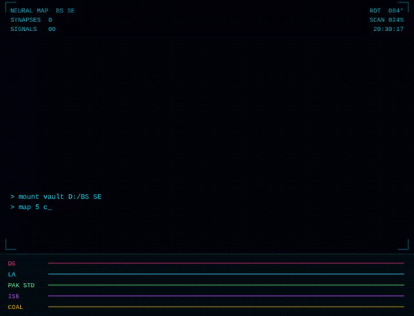

# Cyber Brain

**An Obsidian plugin that turns your vault into a rotating, holographic brain.** Each course folder lives in its own brain region, every note is a synapse, and real links between notes carry signals when you open or edit them.

**[Try the live demo](https://hannannrf.github.io/obsidian-cyber-brain/demo/)**: it runs the plugin's own code in your browser with my real semester vault (205 notes, about 450 links; titles and links only, no note contents). No Obsidian needed.

## What it does

- **Maps folders to brain regions.** Frontal, parietal, temporal, occipital lobes and the cerebellum each hold one folder you choose. The note you pick as home sits at the brainstem and connects to every region. Notes outside those folders float in the core.
- **Uses your real link graph.** Nodes are your notes, sized by how connected they are. Links inside a course are drawn as straight wiring; links between courses arc through the middle of the brain.
- **Reacts to what you do.** Opening a note fires a signal that travels three hops along its links; editing a note makes it flash. The activity traces at the bottom pick up when a region is busy.
- **Movie-style HUD.** Boot sequence, slow 3D rotation, an MRI-style scan plane, target lock with an info panel on hover, scanlines and an occasional glitch. Each effect can be switched off.

## Controls

| Action | Result |
|---|---|
| Hover (or tap) a node | Lock on and show its region, course and link count |
| Click a node | Open the note in a new tab (Ctrl/Cmd-click: split) |
| Drag | Orbit the brain |
| Scroll | Zoom |
| Double-click | Reset zoom and tilt |
| Toolbar | Replay the boot sequence, pause or resume rotation |

Open the view from the brain icon in the left ribbon or with the **Open cyber brain** command.

## Install

The plugin isn't in the community directory yet, so install it manually:

1. Download `main.js`, `manifest.json` and `styles.css` from the [latest release](https://github.com/hannannrf/obsidian-cyber-brain/releases/latest).
2. Put them in `<your vault>/.obsidian/plugins/cyber-brain/`.
3. In Obsidian, go to **Settings → Community plugins**, reload the list and enable **Cyber Brain**.
4. In **Settings → Cyber Brain**, pick which folder goes in each brain region and give each a short label.

Built and tested on Obsidian desktop. Touch input (tap to lock on, drag to orbit) is tested in mobile browsers through the demo, but not yet in the Obsidian mobile app.

## Settings

| Setting | What it does |
|---|---|
| Brain regions | A label and a folder for each of the five regions |
| Brainstem note | The note at the brainstem (default `Home.md`) |
| Folder wiring | Faint links from every note to its folder's hub note, even where you haven't linked them yourself. Turn off to show real links only |
| Notes outside courses | Show notes from other folders in the brain core |
| Ambient signals | Random signals while idle |
| Signals on open | Fire signals from a note when you open or edit it |
| Glitch, scanlines | Visual effects |
| Rotation speed | 0 stops auto-rotation |

## How it works

All of it is drawn on a plain 2D canvas, with no 3D or graphics library.

- **3D projection by hand.** Every node has an (x, y, z) position. Each frame rotates the points around the vertical axis by the current angle, tilts them around the horizontal axis, then applies a perspective divide (`f = 620 / (620 + z)`) so nearer points render larger and brighter. Nodes are depth-sorted back to front before drawing.
- **The brain shape.** The cortex is an ellipsoid flattened on its underside, split into lobes by position. The cerebellum is a second ellipsoid tucked under the back. The faint outline is a few hundred points scattered on the surface with a ripple that suggests folds.
- **Stable placement.** Each note's position comes from a random generator seeded by a hash of its file path, so a note always lands in the same place across reloads. Positions are picked by rejection sampling inside the note's lobe, with a minimum spacing that shrinks as a folder gets fuller. Each course's hub note sits at the centre of its notes.
- **The link graph.** Built from Obsidian's resolved-link index, deduplicated into undirected edges, with an adjacency list used for hover highlighting and for signal propagation.
- **Signals.** A fired node sends pulses along a random subset of its links; each pulse fires its target when it arrives, up to a set depth.
- **Staying cheap.** One `requestAnimationFrame` loop, which idles when the view is hidden. The graph rebuilds only after the vault's link index changes, debounced.

## Built with

Plain JavaScript (no build step), the Obsidian plugin API and the Canvas 2D API. Built with Claude as a pair programmer.

## License

[MIT](LICENSE)
